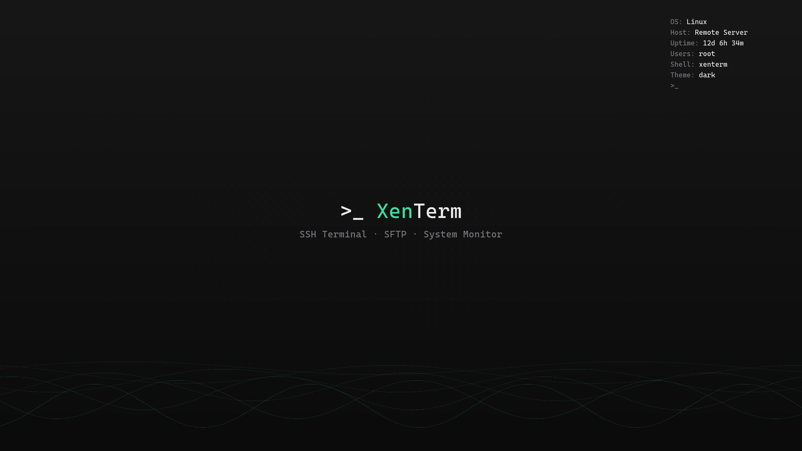
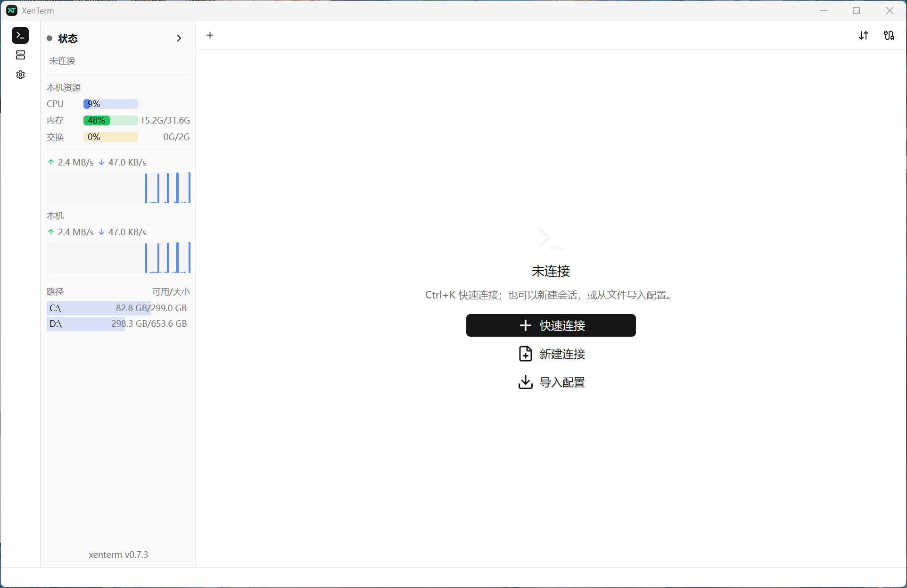
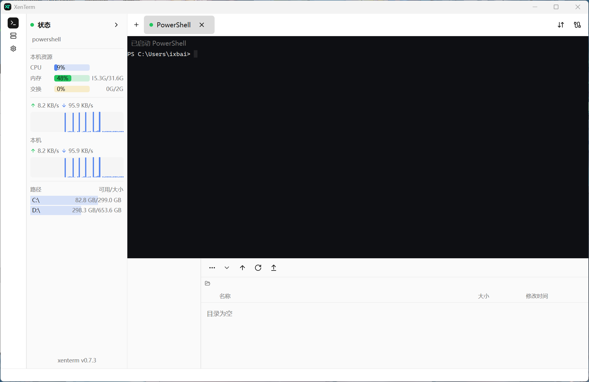

> **XenTerm Next（XenTerm-Next）** 是由 [xue-ding-e](https://github.com/xue-ding-e) 创建并维护的独立 SSH、SFTP 与终端项目，基于 [ixbaicn/XenTerm](https://github.com/ixbaicn/XenTerm) 发展。我们打造自己的下一代终端体验，包含 Next 自有增强，以及经审查整合、可能尚未进入上游的社区修复。本项目不是 XenTerm 官方发行版，也不代表官方下一版本的承诺；保留上游作者归属、版权及 MIT 许可证。
>
> 自有开发维护在 `main`；`upstream-main` 保留官方历史。每日只读工作流检查差异，经核验的镜像快进另行执行，上游更新不会自动替换 Next 功能。详见[分支约定](CONTRIBUTING.zh-CN.md#独立仓库的分支约定xue-ding-exenterm-next)。
>
> XenTerm Next 继续独立维护 Rust + GPUI 桌面架构，不跟随官方的 Rust 核心 + Flutter 迁移。只有仓库负责人 **xue-ding-e** 明确通知并决定后才重新评估迁移；在此之前，仅择取适用于当前 GPUI 架构、经过独立审查和测试的上游修复。`upstream-main` 镜像与差异报告不代表 Next `main` 的迁移授权。

<p align="center">
  <a href="README.md">English</a> · <b>简体中文</b>
</p>

<h1 align="center">XenTerm Next</h1>

<p align="center">
  <em>面向 Windows / macOS / Linux 的轻量级 SSH / SFTP / 终端客户端 —— 纯 Rust 编写，无运行时、无 JVM。</em>
</p>

<p align="center">
  <a href="https://github.com/xue-ding-e/XenTerm-Next/stargazers"></a>
  <a href="https://github.com/xue-ding-e/XenTerm-Next/releases"></a>
  <a href="https://github.com/xue-ding-e/XenTerm-Next/commits/main"></a>
  <a href="#%E8%AE%B8%E5%8F%AF%E8%AF%81"></a>
</p>

<p align="center">
  
</p>

---

## XenTerm Next 是什么

**XenTerm Next** 是 **xue-ding-e 创建并维护的独立终端项目**，面向希望在同一套代码中使用原生 Rust 桌面客户端与可脚本化 CLI / MCP 工作流的用户。“Next”代表我们自己的发展方向：在 XenTerm 基础上打造下一代体验，持续开发自有增强并审查整合社区贡献，不是官方下一版本的名称。

### 为什么选择 Next？

Next 有自己的开发与发行节奏。以下能力已在本仓库实现；截至 **2026-10-16**，相较[上游 `f25f6af`](https://github.com/ixbaicn/XenTerm/tree/f25f6afcd82429d2286526c33c9ea257cb34809f) 包含这些额外增强：

- **GUI 会话导出的私密与禁止覆盖策略**：图形界面保持安全导出策略，目标已存在时提示失败，不退回普通覆盖写入。查看[实现](src/ui/impls/shell.rs)与[回归测试](src/ui/impls/file_dialog_tests.rs)。
- **可追溯的 Next 桌面预览发行**：[beta 流水线](.github/workflows/next-beta.yml)以成功的 main CI 为来源，提供绑定源码 SHA、构建元数据和 SHA256 校验的跨平台包。[下载当前预览版](https://github.com/xue-ding-e/XenTerm-Next/releases/tag/beta)。
- **专用 headless 服务器打包**：[构建与发布入口](docs/headless-server.md)复用已有共享核心，验证 Ubuntu 22.04 ABI / 运行时依赖，并支持固定源码版本的发行。CLI / MCP 共享核心承接上游工作，Next 增加的是打包工作流，不是另写一套业务实现。
- **安装器构建能力与生命周期测试**：[Windows MSI](wix/main.wxs)和 [macOS 安装包](packaging/macos)提供可选集成，并有 [Windows](tests/windows_installer_test.py)及 [macOS](tests/macos_installer_test.py)回归覆盖。这些是安装器构建能力；当前滚动 beta 下载提供的是便携归档包。

上游以后可能接纳或独立实现类似改进。Next 也整合 XenTerm 社区其他作者的贡献并保留署名；“Next 已提供”不等于所有功能都是我们原创，也不等于每项自有改动都已有待合并的上游 PR。

如果这些工作流对你有帮助，欢迎 **[为 XenTerm Next 点一个 Star](https://github.com/xue-ding-e/XenTerm-Next)**，支持项目并帮助更多开发者发现它。也欢迎试用预览版、提交可复现的问题，持续关注这里的独立开发。

XenTerm 是一个原生桌面终端客户端。它保留了大家喜欢 FinalShell 的那些部分——资源监控侧栏、
会话管理、多标签页终端、跟随 Shell 的 SFTP 面板，同时去掉了不喜欢的部分：几百 MB 的 JVM。
它是一个单独的 Rust 二进制文件，界面直接构建在 [GPUI](https://gpui.rs) 之上，
进程里既没有解释器，也没有 Web 运行时和垃圾回收器。

它是客户端，而不是 Shell 的重新实现：SSH、Telnet、串口会话最终都是和对端真实的程序通信，
本地 Shell 则运行在真正的 PTY / ConPTY 里。

| | |
| --- | --- |
| **会话类型** | SSH、本地 Shell（PowerShell / cmd / WSL / `$SHELL`）、Telnet、串口 |
| **文件传输** | SFTP 文件面板、批量下载、终端内 ZMODEM、WebDAV 同步 |
| **终端能力** | 完整 VT/ANSI、鼠标追踪、DEC 线框字符、彩色 emoji、分屏 |
| **资源监控** | 本机 + 远端 CPU / 内存 / 交换 / 磁盘 / 网络，远端进程列表 |
| **自动化** | 面向脚本和 CI 的 `cli`，以及面向 AI 客户端的 MCP 服务 |
| **界面** | GPUI 渲染，中英双语，面板可折叠可停靠 |

## 界面

窗口是一条导航栏加同一时刻的一个页面——共三个页面，每个页面自己持有状态，
只把越过页面边界的事报告给外壳：

- **终端** —— 实际工作的界面：标签栏、可嵌套的横向分屏、带快捷命令与历史记录浮层的
  悬浮命令行、资源侧栏，以及停靠在下方或右侧的文件面板。
- **连接** —— 已保存的会话与内置本地 Shell，带分组、导入导出和会话编辑器。
- **设置** —— 下表中列出的全部选项。

两个监控界面是独立窗口而不是面板，因为它们是你要一边在终端里干活、一边放在旁边看的表格：
**进程监控** 和 **系统信息**。传输列表、隧道列表和文件面板则是面板，
因此始终附着在拥有这些会话的那个窗口上。

## 功能

### 会话与连接

- **四种会话类型** —— SSH、本地 Shell、Telnet、串口，共用同一套标签页界面。
- **开箱即用的本地 Shell** —— Windows 上是 PowerShell、`cmd.exe` 以及所有已配置的 WSL
  发行版；其他平台使用 `$SHELL`。Windows Shell 默认以 UTF-8 启动。
- **多级跳板** —— 在会话编辑器的“多级跳板”页选择已保存的 SSH 会话，按实际连接顺序添加、上下移动或移除；每级独立使用自己的密码或私钥，旧单跳配置仍兼容。
- **SSH 认证方式** —— 密码、私钥、带密码短语的私钥，以及用于 2FA / OTP 提示的键盘交互。
- **PuTTY `.ppk` 私钥** —— PPK v2/v3 在内存中解密并校验，无需先用 `puttygen` 转换。
- **出站代理** —— SOCKS5（`socks5://`、`socks5h://`）与 HTTP/HTTPS CONNECT，可按会话配置，
  也会读取 `ALL_PROXY`。Telnet 使用同一套逻辑。
- **串口** —— 可配置波特率、数据位 / 停止位、校验位与流控。
- **Telnet** —— 带 RFC 854/855 选项协商状态机（SGA + NAWS 窗口尺寸同步）。
- **触发器** —— expect/send 规则，用于交互式登录，每条规则可带独立的应答内容。
- **会话分组** —— 新建、重命名、删除分组，每个会话可写备注。
- **主机密钥校验** —— 首次连接提示 SHA-256 指纹并要求确认；之后密钥变化会给出明确警告。

> 多级跳板在界面中按“本机 → 最外层跳板 → 内层跳板 → 目标”排列。
> 导入的 `jump_session_ids` 数组也按这个顺序，非空时优先于旧 `jump_session_id`。
> 循环、重复、缺失、非 SSH 或超过 16 级的链路会在联网前报错。
> 按会话指定的字符编码仍可通过导入配置设置。

### 终端

- **完整 VT/ANSI 模拟** —— `htop`、`btop`、`vim`、`tmux` 等全屏程序正常渲染，
  回滚缓冲 10 万行。
- **鼠标追踪** —— SGR 与 X10 鼠标事件会转发给主动请求的 TUI 程序，
  因此 `htop`、`mc` 都能响应点击。
- **DEC 线框字符** —— 支持 VT100 特殊图形字符集，即使处于 UTF-8 模式，
  `dialog`、`mc` 的边框也能正确绘制。
- **彩色 emoji** —— 肤色、旗帜以及 ZWJ 组合序列都是彩色的，图形取自内嵌在二进制里的
  Twemoji 图像。
- **字符编码** —— 终端按会话解码字符集（默认 UTF-8，也支持 GBK 等），采用流式解码，
  因此一个多字节字符被拆到两个数据包也不会乱码。
- **输出高亮** —— 为日志级别着色（内置 DevOps 预设），也可自定义规则，
  且不会破坏本身已带颜色的输出。
- **分屏** —— 可嵌套的横向分屏，从标签页右键菜单创建；拖动分隔条调整比例。
  标签页可以在标签栏内拖动排序，也可以从同一个菜单左右移动。
- **回滚缓冲内查找**；翻页键在普通屏幕上滚动回滚缓冲，在备用屏幕上则按预期交给程序处理。
- **粘贴保护** —— 多行粘贴可要求确认，额外的粘贴快捷键（`Ctrl+Alt+V`、`Shift+Insert`）
  可以关闭。
- **字体与光标** —— 任意已安装的等宽字体，另有一款内置字体；字号、行距、粗体，
  以及方块 / 竖线 / 下划线光标和自定义光标颜色。

### 静态终端壁纸（默认关闭）

打开 **设置 → 壁纸**，导入 PNG、JPEG、WebP 或 BMP 并启用预览。
**应用**才会保存完整草稿；**取消修改**恢复已保存设置，**恢复默认草稿**不会保存。
升级前的配置默认保持关闭，包括曾使用旧界面背景选项的配置。

- 覆盖、适应、拉伸、原尺寸、平铺；九宫格锚点、偏移和缩放。
- 非破坏性裁剪、任意角度旋转、直角旋转快捷键和水平/垂直翻转；先应用 EXIF 方向。
- 图片不透明度与黑色可读性遮罩分别控制，支持亮度、饱和度和模糊；
  不改变文字、显式单元格背景、选区和光标。
- **各终端面板**分别布局；**连续终端画布**按窗口坐标对齐分屏中的背景，
  不会使工具栏、侧栏、设置或对话框透明。编辑器仅预览一个画布，不自动按主题重新着色。

图片仅导入到当前配置的 `wallpapers/` 目录，按内容哈希保存不可变副本，保留原始字节与元数据。
取消草稿可能留下已导入的原图。迁移完整配置时，请把该目录和 `sessions.db` 一起迁移；
会话导出和 WebDAV 同步不打包图片。资源缺失或无效时回退为终端底色，并在编辑器显示错误。
不支持远程图片 URL、动态背景、SVG 或视频。

单文件上限 32 MiB，解码上限 33,554,432 像素且单边不超过 16,384 像素；
处理后纹理上限 4,194,304 像素且单边不超过 4,096 像素。
原尺寸模式在降采样后仍保留逻辑原图尺寸。解码/变换在后台防抖、串行执行并缓存；
这些是单图片限制，不是整个应用的内存硬上限。

控件概念参考 [Windows Terminal](https://learn.microsoft.com/en-us/windows/terminal/customize-settings/profile-appearance#background-images-and-icons)、
[IntelliJ IDEA](https://www.jetbrains.com/help/idea/setting-background-image.html) 和
[WezTerm](https://wezterm.org/config/lua/config/background.html) 的官方文档；
未复制这些项目的壁纸素材或实现代码。

验证命令：`cargo check --locked`、`cargo test --locked wallpaper`、
`cargo test --locked` 和 `cargo test --locked --no-default-features --features headless`。
Linux 原生界面的验证不能代替 Windows、macOS 原生交互验证；请以对应提交的 PR 验证记录为准。

### 文件

- **SFTP 面板** —— 跟随终端的 `cd` 切换目录，带懒加载目录树。
- **上传与下载** —— 单个文件或整个目录树，通过工具栏或文件面板的右键菜单操作。
- **批量下载** —— 所选条目先在远端打包，再作为一个文件传回，随后清理远端临时文件。
- **内置查看器 / 编辑器** —— 用于小文件的纯文本编辑器，只读文件则以只读方式打开；
  用你自己的编辑器打开后，保存时会自动回传。
- **文件操作** —— 重命名、删除、新建文件 / 目录，以及保留 setuid / setgid / sticky 位的
  `chmod`。
- **跨会话复制** —— 把远端文件从一个 SFTP 会话复制到另一个会话。
- **冲突处理** —— 每次下载可选择覆盖或保留两者。
- **ZMODEM** —— 终端内直接可用：远端执行 `sz` 会下载到「下载」目录；执行 `rz`
  会弹出本地文件选择器，通过现有 PTY 上传。
- **WebDAV 同步** —— 手动上传 / 下载连接列表，可选择接受自签名证书。

### 资源监控

- **本机面板** —— CPU、内存、交换、网络吞吐、各文件系统用量，配迷你走势图。
- **远端监控（走 SSH）** —— 在服务器上读取 `/proc` 和 `df`，得到同样的指标，每两秒刷新一次。
- **远端进程列表** —— 按 CPU 排序，可复制 PID，可结束属于自己的进程；
  向其他用户的进程发信号前会先询问。
- **系统信息窗口** —— 操作系统、内核、架构、主机名、CPU、内存、文件系统与 GPU。

### 自动化

- **CLI** —— 一次性 SSH 命令、文件列举 / 读取 / 传输、会话信息查询，
  输出可读文本或 `--json`。
- **MCP 服务** —— 通过本机 stdio 把已保存的会话暴露给支持 MCP 的 AI 客户端：
  会话查询、远端命令、目录浏览、有界文本读取、上传与下载。每项能力都有独立权限开关，
  凭据永远不会返回给客户端。

## 截图

<p align="center">
  <br>
  <em>落地页：左侧导航栏与状态面板，中间是快速连接 / 新建连接 / 导入配置</em>
</p>

<p align="center">
  <br>
  <em>标签页里的本地 PowerShell 会话，下方停靠着文件面板</em>
</p>

## 安装

本独立仓库尚未发布安装包。要使用 `main` 中的增强功能，请按[快速开始](#快速开始)从源码构建；后续安装包以[本仓库 Releases](https://github.com/xue-ding-e/XenTerm-Next/releases) 实际内容为准。下述说明介绍继承的 Windows、macOS 和 Linux 包格式，不表示这些包已发布。上游安装包见[官方 Releases](https://github.com/ixbaicn/XenTerm/releases)，不包含本仓库全部增强功能。

### Windows

- **安装程序** —— 运行 `xenterm-<版本>-windows-x86_64.msi`，可自选安装位置。原生功能选择页默认选中「加入 PATH」「桌面快捷方式」「开始菜单」，可分别取消；不同数字版本之间的升级保留所选功能。同一版本号的重复构建不视为无缝升级；安装新的同版本预览包前，请先通过 Windows「已安装的应用」卸载旧包。PATH 采用 Windows Installer 增量维护，卸载不覆盖其他 PATH 项；新终端才能读取更新。
- **免安装** —— 解压 `xenterm-<版本>-windows-x86_64.zip`，双击 `xenterm.exe`。

### macOS

除便携 ZIP 外，打包流水线新增 `.pkg` 安装器：安装应用到 `/Applications`，在“自定”中默认选中可取消的 CLI 入口。macOS 没有开始菜单，不自动修改 Dock 或猜测用户桌面。每次安装仍默认选中 CLI；取消只跳过本次组件，不删除既有入口，也尚未记忆上次取消偏好。未签名/未公证的包不能视为已通过系统安全认证。构建及安全卸载见 [macOS 安装器说明](packaging/macos/README.zh-CN.md)；以所下载版本实际包含的资产为准。


下载得到的是包含 `xenterm.app` 的 `.zip`：

```bash
# aarch64 = Apple 芯片，x86_64 = Intel
unzip xenterm-*-macos-*.zip

# 可选：移动到「应用程序」（留在原地也能运行）
mv xenterm.app /Applications/

# 去掉隔离属性，否则 macOS 会提示「xenterm 已损坏，无法打开」
xattr -dr com.apple.quarantine /Applications/xenterm.app

open /Applications/xenterm.app
```

如果没有移动它，把上面两条路径换成 `.app` 实际所在的位置即可。需要 macOS 11 Big Sur 或更高版本。

### Linux

| 安装包 | 命令 |
| --- | --- |
| Debian / Ubuntu | `sudo apt install ./xenterm-*-linux-amd64.deb` |
| Fedora / 其他 | `tar -xzf xenterm-*-linux-x86_64.tar.gz` |
| Flatpak | `flatpak install --user xenterm-*.flatpak` |
| AppImage | `chmod +x xenterm-*.AppImage && ./xenterm-*.AppImage` |
| Arch（AUR） | `yay -S xenterm-bin` |

tar 包可直接运行：

```bash
tar -xzf xenterm-*-linux-x86_64.tar.gz
cd xenterm-*-linux-x86_64
./xenterm

# 可选：将程序、图标和启动器安装到 /usr/local
# 仅目标目录需要权限时请求 sudo；root 不需要 sudo
chmod +x install-linux.sh && ./install-linux.sh

# 或仅为当前用户安装到 ~/.local，不使用 sudo
./install-linux.sh --user

# 或指定安装目录（路径包含空格时请加引号）
./install-linux.sh --prefix "$HOME/Apps/XenTerm"
# 等价的环境变量写法；仍可传入可选的二进制文件路径
PREFIX="$HOME/Apps/XenTerm" ./install-linux.sh /path/to/xenterm
```

用户安装默认启用 shell PATH、桌面快捷方式及应用菜单；没有 XDG 桌面的服务器会跳过桌面。可用 `--no-add-to-path`、`--no-desktop-shortcut`、`--no-start-menu` 分别取消，后续安装保留选择。用同一前缀执行 `./install-linux.sh --user --uninstall` 仅清理未被修改的托管文件，用户配置不删除。系统安装不猜测登录用户，也不修改用户 shell；`/usr/local/bin` 是否在 PATH 中取决于系统环境。已有 `.deb` 继续由包管理器维护，Flatpak 不承诺宿主机 CLI 入口。

默认安装前缀为 `/usr/local`。安装器会创建 `<prefix>/bin/xenterm`、
`<prefix>/share/applications/xenterm.desktop` 和
`<prefix>/share/icons/hicolor/512x512/apps/xenterm.png`。前缀优先级为
`--prefix` > `PREFIX` 环境变量 > 默认值（使用 `--user` 时为 `$HOME/.local`）。
`--user` 绝不调用 sudo；所选目标不可写时会明确报错。
相对前缀会转换为绝对路径。包含 `=` 或控制字符的前缀无法构成安全的桌面启动路径，会被拒绝。

启动器及其「新建窗口」动作均使用已安装程序的绝对路径，不依赖 `PATH`。
若要在命令行使用，请将 `<prefix>/bin` 加入 `PATH`。
自定义前缀若不在桌面搜索路径内，还需在桌面会话环境中将 `<prefix>/share` 加入
`XDG_DATA_DIRS`，然后注销并重新登录。

其他位置的用户启动器会保留；若可能遮蔽本次安装，安装器会给出提示。
再次运行脚本可以更新带有本安装器管理标记的启动器，也能升级原版安装器生成且
未经修改的启动器（要求内容完全一致）。如果目标启动器没有管理标记，且与原版模板
不一致，安装会在修改文件前停止。请检查并移走该自定义启动器后重试。

> 需要 glibc ≥ 2.35（Ubuntu 22.04+ / Debian 12+）。如果需要更老的基线，`-glibc228`
> 后缀的 tar 包是针对 glibc 2.28（Debian 10）构建的。

> 在 Wayland 下，安装图标后可能需要注销重登一次，桌面环境才会认到这个图标。

## 快速开始

### Rust 工具链支持范围
验证证据：[Rust 1.99.1 Linux 桌面 CI](https://github.com/xue-ding-e/XenTerm-Next/actions/runs/39570649230/job/119123663957)、[1.88 失败](https://github.com/xue-ding-e/XenTerm-Next/actions/runs/39698435848)、[1.92 失败](https://github.com/xue-ding-e/XenTerm-Next/actions/runs/39709879675)、[1.93 失败](https://github.com/xue-ding-e/XenTerm-Next/actions/runs/39711092025)。


包的 Rust 1.88 声明是按特性划分的基础门槛，不表示所有特性和平台均支持 Rust 1.88：

- Linux 无界面：已验证 Rust 1.88，使用 `--locked --no-default-features --features headless`。
- 默认 Linux 桌面：当前锁定的 GUI 依赖声明至少需要 Rust 1.92，但实际检查已确认 Rust 1.88 被拒绝、Rust 1.92 因 `gpui-pre-util` 使用 `slice::as_array` 编译失败；该 API 在 Rust 1.93 稳定。Rust 1.93 的实际检查也因 `gpui-pre` 使用 `std::hint::cold_path` 失败，该 API 在 Rust 1.95 稳定。同源码现有 Linux 桌面 CI 已在 Rust 1.99.1 通过；这是已验证工具链，不是最低版本证明。
- Windows、macOS 桌面：现有 CI 验证 stable Rust，未验证固定最低 Rust 版本。编译也不替代原生交互测试。

保留 `Cargo.lock` 并使用 `--locked`，不要忽略 Rust 版本检查或仅为套用无界面最低版本而降低 GPUI 依赖。
跟踪与精确证据见 [issue #11](https://github.com/xue-ding-e/XenTerm-Next/issues/11)。

```bash
git clone --branch main https://github.com/xue-ding-e/XenTerm-Next.git
cd XenTerm-Next
cargo run --release
```

首次启动会创建一个空的会话库。点击 **新建会话** 添加第一台服务器，或者直接导入：
`~/.ssh/config`、FinalShell 连接导出文件、XenTerm 自己的导出文件，以及
`host|port|user|password|name` 格式的粘贴列表都支持。

### 在 Linux 上构建

`cargo run` 需要先安装界面栈链接的系统开发包：

```bash
sudo apt update
sudo apt install -y --no-install-recommends \
  build-essential pkg-config cmake \
  libfontconfig1-dev libfreetype6-dev \
  libxcb1-dev libxcb-render0-dev libxcb-shape0-dev libxcb-xfixes0-dev \
  libxkbcommon-dev libxkbcommon-x11-dev libwayland-dev \
  libgl1-mesa-dev libegl1-mesa-dev libgtk-3-dev \
  libudev-dev
```

## 快捷键

下表中的 `⌘` 表示 macOS 上的 Command 键，其他平台对应 `Ctrl`。剪贴板这一组是有意这样安排的：
单独的 `Ctrl+C` 仍然是 `SIGINT`——这是终端唯一不能让出的快捷键。

| 按键 | 功能 |
| --- | --- |
| `Ctrl+Tab` / `Ctrl+Shift+Tab` | 下一个 / 上一个标签页 |
| `Ctrl+K` | 快速连接面板 |
| 已断开的会话上按 `Enter` | 重新连接 |
| `Ctrl+Shift+C` | 复制选中内容 |
| `Ctrl+V` / `Ctrl+Shift+V` | 粘贴 |
| `Ctrl+Alt+V` / `Shift+Insert` | 额外粘贴快捷键（可关闭） |
| `Ctrl+F` | 在终端中查找；`Esc` 关闭查找栏 |
| `Ctrl+=` / `Ctrl+-` / `Ctrl+0` | 缩放当前会话字体 |
| `PageUp` / `Home` / `PageDown` / `End` | 滚动回滚缓冲（仅普通屏幕） |

第二个窗口从操作系统自己的入口打开——Windows 任务栏跳转列表、macOS 程序坞菜单，
或 Linux 的桌面动作；该入口会再启动一个进程，而不是转发给已有实例。

## 设置

**界面** —— 主题（跟随系统 / 深色 / 浅色）、面板字号、界面语言。

**终端**

| 页面 | 选项 |
| --- | --- |
| 字体 | 字体族（任意已安装的等宽字体，以及内置字体）、字号、粗体、行距 |
| 光标 | 形状（方块 / 竖线 / 下划线）与颜色 |
| 输入 | 多行粘贴确认；额外粘贴快捷键；面板区域高度 |
| 输出高亮 | 启用输出高亮、预设（日志级别 / DevOps），以及自定义规则的添加 / 启用 / 删除 |

**连接** —— 导入 `~/.ssh/config`、把全部已保存连接导出到文件。
**粘贴**（位于「连接」下）—— 粘贴 `host|port|user|password|name` 列表并批量导入。
**文件** —— 默认下载目录，以及是否每次都询问保存位置。
**同步** —— WebDAV：启用、地址、用户名、密码、远端路径、接受无效证书，
以及上传 / 下载按钮。
**自动化** —— 四个开关，按它们实际管的东西分开：**无人值守访问**（使用已保存的凭据、
允许执行任意 SSH 命令、允许文件传输）和 MCP 服务器自己的 **MCP 服务器** 开关。

## CLI 与 MCP

CLI 与 MCP 服务共用 GUI 中保存的会话和同一套 SSH / SFTP 实现，因此只需要维护一份服务器列表。
CLI 适合脚本、CI 和明确的手动命令；MCP 让 AI 客户端用自然语言完成服务器巡检、日志分析、
文件传输。

> 使用前请先在 GUI 中创建并成功连接一次目标会话，以完成主机密钥确认。普通 CLI / MCP 响应
> 不会暴露密码或私钥；显式 CLI 导出会把可恢复的凭据写入私密文件。也不要把明文密码写进提示词或 MCP 配置文件。

### CLI

```bash
xenterm cli help
```

```bash
# 列出已保存的会话，第一列是后续命令要用的 session-id
xenterm cli sessions
xenterm cli sessions --json

# 查看单个会话的非敏感信息
xenterm cli session <session-id>

# 执行非交互式命令，远端命令放在 -- 之后
xenterm cli exec <session-id> -- free -h
xenterm cli exec <session-id> --timeout 60 --json -- journalctl -n 100 --no-pager

# 浏览、读取和传输远端文件
xenterm cli files <session-id> /var/log
xenterm cli read <session-id> /var/log/example.log
xenterm cli upload <session-id> ./local.txt /tmp
xenterm cli download <session-id> /tmp/result.txt ./downloads

# 只读查看当前有效访问策略
xenterm cli permissions --json

# 显式私密导出：选择配置目录之外的新文件
xenterm cli export ./private-sessions.json --include-credentials

# 先预览追加导入
xenterm cli import ./private-sessions.json --dry-run --json

# 在使用本地凭据存储的独立配置目录中预览稳定 ID 迁移
xenterm --data-dir ./migration-profile cli import ./private-sessions.json --preserve-ids --dry-run --json
xenterm --data-dir ./migration-profile cli sync-native ./sessions.json --dry-run --json
```

下载要求本地目标目录已经存在，且不会覆盖同名文件。

便携导出包含可恢复的凭据，必须妥善保密；只包含已保存的会话，不包含全局设置、主机信任记录
或外部密钥文件，且拒绝覆盖已有目标文件。上面的导入和 `sync-native` 示例只做预览，去掉
`--dry-run` 才会写入配置。跨配置目录迁移应先使用便携导入；原生加密快照仍要求匹配的本地
加密密钥，导入便携会话不会让另一个配置目录的密文变得可读，也不能导入系统钥匙串标记。
Headless CLI / MCP 同样要求显式独立的 `--data-dir`（放在子命令之前）或 `XENTERM_DATA_DIR`，
不要指向桌面配置目录。详见[配置迁移说明](docs/REMOTE_MCP.md)。

### MCP

打开 XenTerm 的 **设置 → 自动化 → MCP 服务器**，按需开启：
先启用 MCP，再根据需要允许使用已保存凭据、执行任意 SSH 命令和文件传输。
在 MCP 仍处于预览阶段时，这三个「无人值守访问」开关默认是开启的。

然后在 MCP 客户端里注册 stdio 服务：

```json
{
  "mcpServers": {
    "xenterm": {
      "command": "/absolute/path/to/xenterm",
      "args": ["mcp", "serve"]
    }
  }
}
```

Windows 下 `command` 可以填 `C:\\path\\to\\xenterm.exe`。重启或刷新客户端后，应当能看到名为
`xenterm` 的服务，工具以 [`src/mcp/impls/tools.rs`](src/mcp/impls/tools.rs) 的注册定义为准：
`get_access_policy`、`import_sessions`、`list_sessions`、`get_session`、`run_command`、
`list_remote_files`、`read_remote_text_file`、`upload_file`、`download_file`。
不同 AI 客户端的 MCP 配置文件位置不同，请以对应客户端的文档为准。

`get_access_policy` 只读查询策略。`import_sessions` 默认预览；应用导入要求启动 MCP 时显式传入
`--allow-config-import`，预览和应用都需要文件传输权限。凭据导出只通过本地 CLI 提供，不注册为 MCP 工具。

#### 调试 stdio 连接

一般情况下这些请求由 AI 客户端自动生成。手工调试时，每个请求必须是独立的一行 JSON，
并按以下顺序完成初始化：

```jsonl
{"jsonrpc":"2.0","id":1,"method":"initialize","params":{"protocolVersion":"2025-11-25","capabilities":{},"clientInfo":{"name":"example-client","version":"1.0.0"}}}
{"jsonrpc":"2.0","method":"notifications/initialized","params":{}}
{"jsonrpc":"2.0","id":2,"method":"tools/list","params":{}}
```

查询会话，然后做一次只读的 OOM 诊断并浏览堆转储目录：

```jsonl
{"jsonrpc":"2.0","id":3,"method":"tools/call","params":{"name":"list_sessions","arguments":{}}}
{"jsonrpc":"2.0","id":4,"method":"tools/call","params":{"name":"run_command","arguments":{"session_id":"<session-id>","command":"free -h; dmesg 2>/dev/null | grep -iE 'oom|killed process' | tail -50 || true; ps -ef | grep '[j]ava'","timeout_seconds":30,"max_output_bytes":1048576}}}
{"jsonrpc":"2.0","id":5,"method":"tools/call","params":{"name":"list_remote_files","arguments":{"session_id":"<session-id>","path":"/home/jeff/test/heapdumps"}}}
```

`read_remote_text_file` 只接受有大小限制的 UTF-8 文本；HPROF 之类的二进制文件请用
`download_file`，它要求本地目录已存在，且不会覆盖同名文件。

可以直接对支持 MCP 的客户端说：

> 用 `xenterm` MCP 排查一下：我的 `192.168.100.41` 服务器出现 OOM，堆转储位于
> `/home/jeff/test/heapdumps`。请检查系统内存、内核 OOM 记录、Java 进程、应用日志和
> HPROF 文件，判断根因；先只读排查，不要重启服务或删除文件。

服务会先用 `list_sessions` 找到对应会话，再在已授予的权限范围内操作。若同一主机有多条会话，
请在提示词里写明 GUI 中的会话名称。

## 配置与数据

XenTerm 是 **便携优先** 的：如果可执行文件旁边有可写的 `config/` 目录（U 盘、解压出来的
tar 包），所有数据都放在那里。否则回退到系统的用户配置目录：

| 平台 | 位置 |
| --- | --- |
| Windows | `%APPDATA%\xenterm\XenTerm\config` |
| Linux | `~/.config/xenterm` |
| macOS | `~/Library/Application Support/dev.xenterm.XenTerm` |

从改名前的版本（`meatshell`）升级时，`sessions.json`、`secret.key` 和 `known_hosts` 会自动
迁移：原文件保留不删，且不会覆盖已存在的目标文件。诊断日志写在配置目录旁边的独立 `log/`
目录里，`error.log` 上限 50 MiB。

## 安全说明

- **密码静态存储** —— 只要系统支持，会话密码就存进操作系统钥匙串（Windows 凭据管理器、
  macOS 钥匙串、Linux Secret Service）。不可用时改用 **ChaCha20-Poly1305** 加密，
  密钥是每份安装独立的 `secret.key`，因此 `sessions.json` 里不会出现明文密码。
- **导出的连接列表是可移植的，但不是机密的。** 导出格式使用编进二进制的固定密钥，
  以便文件在任何机器上都能打开——这是混淆，安全级别和 FinalShell 的导出文件相同，
  不应把它当作加密保护。
- **主机密钥** 由 XenTerm 自己记录在 `known_hosts` 文件里（格式为
  `host:port <密钥类型> <base64>`），这与 OpenSSH 的 `known_hosts` 不是同一个文件。
- **凭据在释放时清零**，明文密码不会残留在已释放的内存里。

## 技术栈

| 层次 | 选型 |
| --- | --- |
| 界面 | [GPUI](https://gpui.rs)，通过 `gpui-kit` —— GPU 渲染的 Rust 界面，编译进二进制 |
| 异步运行时 | [`tokio`](https://tokio.rs) |
| SSH / SFTP | [`russh`](https://crates.io/crates/russh) + [`russh-sftp`](https://crates.io/crates/russh-sftp)，纯 Rust，不依赖 libssh |
| 终端模拟 | [`rio-vt`](https://crates.io/crates/rio-vt) 原生网格、滚动历史与缩放重排 |
| 本地 PTY | [`portable-pty`](https://crates.io/crates/portable-pty) |
| 串口 | [`serialport`](https://crates.io/crates/serialport) |
| 系统指标 | [`sysinfo`](https://crates.io/crates/sysinfo) |
| 加密 | [`chacha20poly1305`](https://crates.io/crates/chacha20poly1305)；PPK 解析用 [`aes`](https://crates.io/crates/aes) + [`argon2`](https://crates.io/crates/argon2) |
| 序列化 | `serde` + `serde_json` |
| 日志 | `tracing` + `tracing-subscriber` |

## 项目结构

```
xenterm/
├── Cargo.toml
├── build.rs                    # 在 Windows 上嵌入 assets/xenterm.ico
├── ui/fonts/                   # 内置终端字体（常规 + 粗体）与图标字体
├── assets/                     # 图标、横幅、桌面项、Linux 安装脚本
├── packaging/                  # AUR PKGBUILD 与 Flatpak 清单
└── src/
    ├── main.rs                 # 入口：界面、`cli`、`mcp serve`
    ├── ui/                     # 外壳——页面、面板、对话框、独立窗口
    │   ├── impls/pages/        # 三个页面：终端、连接、设置
    │   └── impls/              # 面板、对话框、终端视图与外壳本身
    ├── app/                    # 会话模型、PTY 泵、窗口与跳转列表接线
    ├── core/                   # 与界面工具包无关的状态：标签页、分屏、映射、历史
    ├── cli/  mcp/  automation/ # 面向脚本与 AI 的统一调度入口
    ├── config/                 # sessions.json、加密、钥匙串、导入导出
    ├── ssh/  sftp/  tunnel/    # 协议与管道
    ├── terminal/               # VT 解析、渲染、ZMODEM、串口、Telnet
    ├── resource/               # 本机采样与远端指标解析
    ├── webdav/  i18n/  layout/  logging/
    └── allocator/              # Unix 上用 jemalloc，Windows 上用 mimalloc
```

## 开发

贡献前请阅读[社区贡献指南](CONTRIBUTING.zh-CN.md)（[English](CONTRIBUTING.md)），了解 PR 组织、冲突处理、审核就绪和 API 版本核验要求。

- **界面只有 GPUI。** 没有需要额外构建的特性开关，也没有第二个要同步维护的前端。
  直接运行 `xenterm` 和迁移期遗留的 `xenterm gpui` 参数打开的是同一个外壳。
- **一个页面就是一个自带状态的视图**，首次进入时创建、之后一直保留，
  所以输入到一半的筛选条件或滚动位置在切走再回来后仍然在。外壳每帧只渲染一个页面；
  页面内做不到的事会排队交给外壳在下一帧开头处理——这也正是「点击永远不在收到它的那次
  渲染里执行」的原因。
- **界面只用图标字体和文字，绝不用 emoji** —— 这一点由扫描 `src/ui` 的测试保证：
  只人工检查过一次的结论只说明那天的状态，不是代码的性质。
- **翻译是成对的字面量**，不是词条文件：`crate::i18n::t("中文", "English")`
  按当前语言开关取用，两种语言都编进二进制。
- **改界面时 `cargo check` 是最快的反馈方式。**
- 用 `cargo test` 跑测试；集成测试放在 `tests/app/` 下。
  目前只有通过 `#[path]` 挂进 `mod.rs` 的三个测试模块会被真正编译，
  所以新增测试时要同时改 `mod.rs`，而不只是建文件。

## 发版

不要手动改 `Cargo.toml` 再打标签。请使用发布脚本，让标签指向的提交本身就已经包含正确的版本号：

```powershell
.\scripts\release.ps1 v0.7.4 -Push
```

脚本会要求已跟踪文件没有未提交改动，更新 `Cargo.toml` 和 `Cargo.lock` 里的 `xenterm`
版本号，运行 `cargo check --locked`，验证 `xenterm --version`，提交 `Release v0.7.4`，
创建 annotated tag，然后推送分支和标签。详见 [docs/release.md](docs/release.md)。

> **从这个代码树首次发版之前**：发布流水线的 Linux runner 可能还需要为 GPUI 的平台库
> 补装 apt 包；GPUI 的 Windows crate 在发布构建时需要 Windows SDK 的 `fxc.exe`
> （debug 构建会跳过这一步）。这两点都记在 `Cargo.toml` 里，而不是当作不存在。

## 社区

<p align="center">
  <br>
  <em>扫码加入 QQ 群，交流使用经验、反馈问题或获取最新动态</em>
</p>

## 鸣谢

- [ixbaicn/XenTerm](https://github.com/ixbaicn/XenTerm) — XenTerm Next 所基于的上游项目。
- [meatshell](https://github.com/yituorou/meatshell)

## 许可证

基于 [MIT 许可证](LICENSE) 开源。贡献代码同样按该协议授权。

第三方署名（包括彩色 emoji 使用的 Twemoji 图形）见
[THIRD_PARTY_NOTICES.md](THIRD_PARTY_NOTICES.md)。


## 无界面 CLI / 认证远程 MCP

使用 `cargo build --locked --release --no-default-features --features headless` 可构建不依赖 GPUI 的 Linux 服务。默认桌面构建保留 GUI、CLI 和 stdio MCP 全部功能。HTTP 模式必须显式选择独立配置目录并配置外部 OAuth 认证，通过已有 OpenResty/Nginx 终止 HTTPS。部署模板、同域名不同路径和验证步骤见 [REMOTE_MCP.md](docs/REMOTE_MCP.md)。
